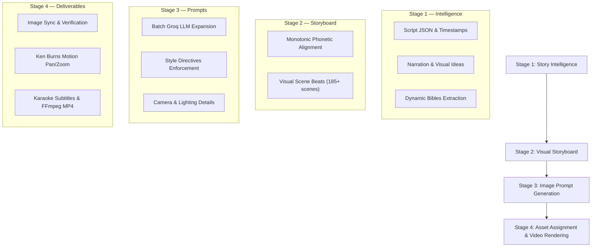

# Script Beanie (PromptBeast Studio Pro) ⚡
### *Narration-Aware Image Prompt Generation & Story-to-Video Production Workstation*

[](https://www.python.org/)
[-green.svg)](https://wiki.qt.io/Qt_for_Python)
[](https://groq.com/)
[](https://ffmpeg.org/)
[](LICENSE)

**Script Beanie** (powered by PromptBeast) is a production desktop application designed to transform spoken voiceover audio, script JSON, and visual breakdowns into production-ready image generation prompts, synchronize every scene with sub-second timestamps, and compile the final video locally with animated subtitles and cinematic motion.

```
Import Audio & Script JSON ➔ Provide Narration & Visual Ideas ➔ Extract Dynamic Bibles ➔ Generate Detailed Prompts (Groq) ➔ Assign Images ➔ Local Video Render (FFmpeg)
```

---

## 📑 Table of Contents
1. [Core Features](#-core-features)
2. [Streamlined 4-Stage Production Pipeline](#-streamlined-4-stage-production-pipeline)
3. [The 11 Visual Art Styles](#-the-11-visual-art-styles)
4. [Master AI Prompts for External LLMs](#-master-ai-prompts-for-external-llms)
5. [Interactive Two-Stage Conversational Protocol](#-interactive-two-stage-conversational-protocol)
6. [Parameters Guide: Strict Rules vs. Tolerance](#-parameters-guide-strict-rules-vs-tolerance)
7. [Groq Multi-Key Pooling & Rate-Limit Rotation](#-groq-multi-key-pooling--rate-limit-rotation)
8. [Installation & Setup](#-installation--setup)
9. [Quick Launch](#-quick-launch)

---

## ⚡ Core Features

- **Bidirectional Asset Ingestion**: Drop or select your voiceover audio (`speech.mp3`) and Script Beanie automatically auto-detects and pairs matching word-level timestamp JSON (`speech.json`) in the same directory.
- **Monotonic Phonetic Alignment**: Paste natural storyboard lines (e.g. `Visual 1 Words: ... Visual: ...`). The difflib sequence aligner automatically matches spoken lines to precise audio millisecond timestamps.
- **Dynamic Story Bibles (Zero Hardcoding)**: Automatically extracts Story, Character, Environment, Object, and Visual Style Bibles dynamically using Groq. Works for any genre: zombie survival, historical, sci-fi, documentary, or fantasy.
- **Custom Bibles Text Importer**: Paste pre-generated or custom bibles in plain human-readable text directly into the studio.
- **11 Authoritative Visual Styles**: Includes **Zombie Survival**, **What-If Flat Vector**, **3D Red & Blue Stickman**, **Century-Old Photograph**, **Mixed-Media Collage**, and more.
- **Master AI Prompts**: Includes 11 fine-tuned, copy-paste prompts designed for ChatGPT, Claude, and Gemini to generate narration-synced storyboards and production bibles.
- **Multi-Key Groq Pooling**: Rotates multiple Groq API keys automatically with real-time rate limit tracking (HTTP 429), exponential cooldowns, and batch recovery.
- **Local FFmpeg Video Compilation**: Zero external GPU or cloud rendering dependencies for video output. Assembles assigned images, audio, Ken Burns camera motion, and animated karaoke subtitles into an upload-ready MP4.

---

## 🏗️ Streamlined 4-Stage Production Pipeline



1. **Stage 1 — Story Intelligence**: Establishes Character Bibles, Environment Bibles, Key Props, and Visual Continuity Rules.
2. **Stage 2 — Visual Storyboard**: Maps narration sentences to concrete visual descriptions and synchronizes audio timestamps.
3. **Stage 3 — Image Prompt Generation**: Expands scenes into camera-ready prompts adhering strictly to the active visual style.
4. **Stage 4 — Asset Assignment & Video Rendering**: Binds images to scenes and compiles the final video using native FFmpeg.

---

## 🎨 The 11 Visual Art Styles

All visual styles are dynamically loaded from `config/visual_styles/*.json`:

| Style ID | Style Name | Visual Category | Key Visual Rules & Locks |
| :--- | :--- | :--- | :--- |
| `zombie_survival` | **Zombie Survival** | 2D Animation / Survival | Pure flat 2D cartoon, heavy black `#1A1A1A` outlines. Locked hero narrator (backwards red cap `#D63A2A`, charcoal hoodie `#333333`, white shirt, brown strap). Uniform olive-green zombie horde (`#8A9A66` skin, white eyes, jagged teeth, tattered brown jackets `#5C4033`). Zero blood/gore. |
| `whatif_flat_vector` | **What-If Flat Vector** | 2D Vector | Minimalist black stick figure with **strictly locked bright RED hoodie (`#FF0000`)** across all scenes, uniform limb thickness. Midnight navy night-world (`#12182E`, `#0A0E17`) with localized warm golden light pools. Zero gradients. |
| `century_old_photograph` | **Century-Old Photograph** | Historical Archival | Authentic damaged archival print. Warm faded sepia, aged albumen, or silver gelatin monochrome. Naturally torn and chipped cardstock borders, dust specks, vertical scratches. Strictly zero modern RGB colors. |
| `bw_vintage_historical_photography` | **B&W Historical Photography** | Archival Monochrome | Genuine archival documentary photography. Realistic human anatomy, authentic period uniforms/clothing, natural monochrome grayscale tonal range, organic film grain. Realistic animals/birds. No 3D/caricature. |
| `3d_red_blue_stickman` | **3D Red & Blue Stickman** | 3D Animation | Stylized 3D CGI toy universe. Strict faction separation: Attackers/Invaders = 100% Solid Bright Red; Defenders = 100% Solid Blue. No color mixing on tasks. Featureless spherical heads, rounded 3D block geometry. |
| `2d_stickman` | **2D Stickman** | 2D Animation | OverSimplified cartoon aesthetic. Bold black outlines, flat pastel/primary fills, large spherical heads with expressive comedic line mouths and dot eyes. Flat 2D theatrical framing. |
| `3d_stickman` | **3D Stickman** | 3D Animation | Tactile CGI hybrid. Soft-toy low-poly 3D modeling with matte finishes. Spherical stick heads with animated eyebrow shifts. Dimensional tactile environments (wood, stone, cloth) with soft ambient occlusion. |
| `mixed_media_collage` | **Mixed-Media Collage** | Editorial Collage | Layered photographic cutouts, printed halftones, archival newspapers, maps, blueprints, and textured paper with physical depth and visible cut edges. |
| `paper_cutout` | **Paper-Cutout Illustration** | Cut-Paper Craft | Layered cardstock 2D animation style. Physically cut paper shapes in distinct depth layers, visible paper fibers, delicate drop shadows, and warm muted historical cardstock tones. |
| `paper_quilling` | **Paper Quilling Illustration** | Handcrafted Papercraft | 100% constructed from narrow standing paper strips rolled, curled, coiled, and folded on edge. Tactile physical relief under directional raking light. |
| `vintage_photograph` | **Vintage Photograph** | Archival Analog | Faded sepia and silver-gelatin tones, organic paper grain, corner vignetting, and delicate emulsion hairline wear. Period-accurate staging and technology. |

---

## 🤖 Master AI Prompts for External LLMs

Located in `config/ai_prompts/`, each visual style has a dedicated prompt file:
- `01_zombie_survival_ai_prompt.txt`
- `02_whatif_flat_vector_ai_prompt.txt`
- `03_century_old_photograph_ai_prompt.txt`
- `04_bw_vintage_historical_photography_ai_prompt.txt`
- `05_3d_red_blue_stickman_ai_prompt.txt`
- `06_2d_stickman_ai_prompt.txt`
- `07_3d_stickman_ai_prompt.txt`
- `08_mixed_media_collage_ai_prompt.txt`
- `09_paper_cutout_ai_prompt.txt`
- `10_paper_quilling_ai_prompt.txt`
- `11_vintage_photograph_ai_prompt.txt`

In the desktop app, clicking **`📋 Copy Master AI Prompt`** in Step 2 or Step 4 immediately copies the prompt for your active visual style to your clipboard.

---

## 💬 Interactive Two-Stage Conversational Protocol

Every prompt enforces this streamlined interaction:

1. **Stage 1 (Prompt)**: You send ONLY the Master Prompt to ChatGPT, Claude, or Gemini.  
   *AI replies ONLY:* `"I am ready. Please provide your story script or narration transcript, and I will generate your optimized visual storyboard."`
2. **Stage 2 (Script)**: You paste your raw story script.  
   *AI replies:* Chronological visual storyboard in exact `Visual X Words: ... Visual: ...` format, followed by: `"Storyboard complete! Reply with 'Generate Bibles' to receive your complete Production Bibles."`
3. **Stage 3 (Bibles)**: You reply `"Generate Bibles"`.  
   *AI replies:* Complete 7-Part Production Bibles (Characters, Environments, Props, Style, Chronology, Rules).

---

## 📐 Parameters Guide: Strict Rules vs. Tolerance

### What You MUST Follow:
- **Format Tag**: `Visual [N] Words: <spoken script words> Visual: <physical visual description>`.
- **Chronological Sequence**: Narration must follow the natural order of your audio from start to finish.
- **100% Script Coverage**: Every spoken line must be assigned to a visual beat.
- **Concrete Visuals**: Describe what the camera actually sees (subjects, action, lighting, shot framing).
- **Style Integrity**: Obey the style's character lock, faction colors, and negative constraints.

### What You Can Safely IGNORE (Handled Automatically):
- **Prefix Labels**: `Visual 1`, `Scene 1`, `Shot 1`, or `1.` are all parsed interchangeably.
- **Letter Case**: `Words:` vs `words:`, `Visual:` vs `visual:` are case-insensitive.
- **Numbers vs. Words**: Variations like `"60"` vs `"sixty"` or `"8:47 PM"` vs `"8 .47 pm"` are automatically synchronized by the phonetic sequence aligner.
- **Timestamps**: **Do NOT write timestamps in your AI output.** PromptBeast automatically reads exact millisecond timestamps from your audio's `speech.json`.
- **Model Codes**: **Do NOT write `--ar 16:9` or Midjourney flags.** Model parameters are attached automatically.
- **Spacing**: Single or double line breaks between visual beats are both handled cleanly.

---

## 🔑 Groq Multi-Key Pooling & Rate-Limit Rotation

Create a file named `groq api.txt` in the project root (see `groq api.example.txt` for format) and paste your Groq API keys (one per line, starting with `gsk_`):

```text
gsk_example_key_1
gsk_example_key_2
gsk_example_key_3
```

PromptBeast's `GroqMultiKeyManager`:
1. Distributes requests across all available keys.
2. Automatically detects HTTP 429 rate limits, reads Groq's `retry-after` header, and temporarily cools down the limited key.
3. Switches immediately to the next ready key so batch generation continues without interruption.

---

## 💻 Installation & Setup

### Prerequisites
- **Python 3.10+** (Python 3.11 or 3.12 recommended)
- **FFmpeg** installed and added to system `PATH` (verify via `ffmpeg -version`)

### 1. Clone the Repository
```bash
git clone https://github.com/mianshahid-official/script-beanie.git
cd script-beanie
```

### 2. Set Up Virtual Environment (Recommended)
```bash
python -m venv venv
# On Windows:
venv\Scripts\activate
# On macOS/Linux:
source venv/bin/activate
```

### 3. Install Dependencies
```bash
pip install -r requirements.txt
```

### 4. Configure API Keys
Copy `groq api.example.txt` to `groq api.txt` and add your Groq API keys:
```bash
copy "groq api.example.txt" "groq api.txt"
```

---

## 🚀 Quick Launch

### Windows One-Click:
Double-click `run.bat` or run:
```bash
run.bat
```

### Cross-Platform Terminal:
```bash
python app/main.py
```

### Run Automated Tests:
```bash
pytest tests/test_4stage_pipeline.py
```

---

## 📄 License
This project is licensed under the MIT License — see the [LICENSE](LICENSE) file for details.
