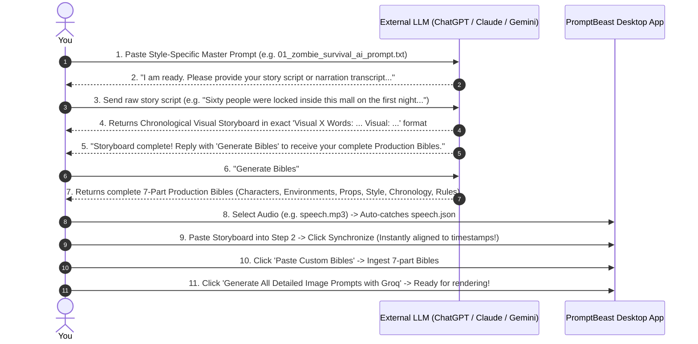

# PromptBeast Master AI Prompts & Style Architecture Guide

Welcome to the **PromptBeast Master AI Prompt System**. This directory contains dedicated, fine-tuned Master Prompts designed to be used with external LLMs (**ChatGPT, Claude, Gemini**) to generate:
1. **Narration-Aware Chronological Visual Storyboards** (in PromptBeast's exact `Visual X Words: ... Visual: ...` format).
2. **Comprehensive 7-Part Production Bibles** (Characters, Environments, Props, Style, Chronology, and Continuity Rules).

Each prompt is custom-tailored to one of PromptBeast's **11 production visual styles**, strictly locking character designs, faction colors, line art thickness, camera framing, and negative visual rules.

---

## 1. Directory of the 11 Dedicated Style Prompts

| File Name | Visual Style | Aesthetic Identity & Key Locks |
| :--- | :--- | :--- |
| [`01_zombie_survival_ai_prompt.txt`](file:///d:/AntiGravity/v2promptbeast/config/ai_prompts/01_zombie_survival_ai_prompt.txt) | **Zombie Survival** | Pure flat 2D cartoon, heavy black outlines (`#1A1A1A`). Locked hero "YOU" (backwards red cap `#D63A2A`, charcoal hoodie `#333333`, white shirt, brown strap). Uniform zombie horde (olive-green `#8A9A66` skin, white eyes, jagged teeth, tattered brown jacket `#5C4033`). Zero gore/blood. |
| [`02_whatif_flat_vector_ai_prompt.txt`](file:///d:/AntiGravity/v2promptbeast/config/ai_prompts/02_whatif_flat_vector_ai_prompt.txt) | **What-If Flat Vector** | 2D flat vector night-world (`#12182E`, `#0A0E17`). Minimalist black stick figure with strictly locked bright RED hoodie (`#FF0000`), uniform limb thickness, tiny white dot eyes. Zero gradients, localized golden light pools. |
| [`03_century_old_photograph_ai_prompt.txt`](file:///d:/AntiGravity/v2promptbeast/config/ai_prompts/03_century_old_photograph_ai_prompt.txt) | **Century-Old Photograph** | Authentic damaged archival print. Warm faded sepia, aged albumen, or silver gelatin monochrome. Naturally torn and chipped cardstock borders, dust specks, vertical hairline scratches. Strictly zero modern RGB colors. |
| [`04_bw_vintage_historical_photography_ai_prompt.txt`](file:///d:/AntiGravity/v2promptbeast/config/ai_prompts/04_bw_vintage_historical_photography_ai_prompt.txt) | **B&W Historical Photography** | Genuine archival documentary photography. Realistic human anatomy, authentic period clothing, natural monochrome grayscale tonal range, organic film grain. Realistic animals/birds. No 3D/caricature. |
| [`05_3d_red_blue_stickman_ai_prompt.txt`](file:///d:/AntiGravity/v2promptbeast/config/ai_prompts/05_3d_red_blue_stickman_ai_prompt.txt) | **3D Red & Blue Stickman** | Fully 3D toy-like CGI universe. Strict faction separation: Attackers/Invaders = 100% Solid Bright Red; Defenders = 100% Solid Blue. No color mixing on tasks. Featureless spherical heads, rounded block geometry. Zero realistic anatomy. |
| [`06_2d_stickman_ai_prompt.txt`](file:///d:/AntiGravity/v2promptbeast/config/ai_prompts/06_2d_stickman_ai_prompt.txt) | **2D Stickman (OverSimplified)** | Iconic OverSimplified cartoon aesthetic. Bold black outlines, flat pastel/primary fills, large spherical heads with expressive comedic line mouths and dot eyes. Flat 2D theatrical framing. |
| [`07_3d_stickman_ai_prompt.txt`](file:///d:/AntiGravity/v2promptbeast/config/ai_prompts/07_3d_stickman_ai_prompt.txt) | **3D Stickman (CGI Hybrid)** | Soft-toy low-poly 3D CGI hybrid. Tactile matte finishes, spherical stick heads with animated eyebrow shifts. Dimensional tactile environments (wood, stone, cloth) with soft ambient occlusion and cinematic lighting. |
| [`08_mixed_media_collage_ai_prompt.txt`](file:///d:/AntiGravity/v2promptbeast/config/ai_prompts/08_mixed_media_collage_ai_prompt.txt) | **Mixed-Media Collage** | Editorial & documentary collage. Layered photographic cutouts, printed halftones, archival newspapers, maps, blueprints, and textured paper with physical layer depth and visible cut edges. |
| [`09_paper_cutout_ai_prompt.txt`](file:///d:/AntiGravity/v2promptbeast/config/ai_prompts/09_paper_cutout_ai_prompt.txt) | **Paper-Cutout Illustration** | Layered cardstock 2D animation style. Physically cut paper shapes in distinct depth layers, visible paper fibers, soft drop shadows between sheets, and a warm muted historical cardstock palette. |
| [`10_paper_quilling_ai_prompt.txt`](file:///d:/AntiGravity/v2promptbeast/config/ai_prompts/10_paper_quilling_ai_prompt.txt) | **Paper Quilling Illustration** | 100% handcrafted paper quilling artwork. Every human, tree, animal, building, and cloud constructed from narrow standing paper strips rolled, curled, and folded on edge. Tactile physical relief under directional raking light. |
| [`11_vintage_photograph_ai_prompt.txt`](file:///d:/AntiGravity/v2promptbeast/config/ai_prompts/11_vintage_photograph_ai_prompt.txt) | **Vintage Photograph** | Timeless analog archival print. Aged sepia and silver-gelatin tones, organic paper grain, corner vignetting, and delicate emulsion hairline wear. Period-accurate staging and technology. |

---

## 2. Interactive Two-Stage Conversational Workflow

All 11 prompts enforce a strict, conversational protocol so you never have to repeat formatting instructions to the external AI:



---

## 3. Parameter Guide: What to Strictly Follow vs. What You Can Ignore

### What Must Be Strictly Followed:
1. **The Two-Tag Structure**:
   ```text
   Visual [Number] Words: [Exact spoken narration words] Visual: [Concrete physical description]
   ```
2. **Strict Chronological Sequence**: The narration in `Words:` must proceed monotonically from the beginning of the audio to the very end. Never jump backwards or skip narration sections.
3. **100% Narration Coverage**: Every sentence spoken in the voiceover must appear in the visual breakdown.
4. **Concrete Physical Visuals**: Always describe physical subjects, actions, lighting, and camera framing (wide, medium, close-up, low-angle). Avoid abstract metaphors or narration repetition.
5. **Style Directives**: Adhere strictly to the chosen style's locked character rules, color hex codes, and negative visual constraints.

### What You Can Safely Ignore (PromptBeast Automatically Adjusts):
- **Prefix Labels**: You can use `Visual 1`, `Scene 1`, `Shot 1`, or simply `1.`. PromptBeast parses all of them.
- **Letter Case**: `Words:` vs `words:`, `Visual:` vs `visual:`, `SCENE 1` vs `scene 1` are handled seamlessly.
- **Word vs. Digit Spelling Differences**: If the audio Whisper transcript has `"60"` or `"8 .47 pm"` and your storyboard has `"Sixty"` or `"8:47 PM"`, PromptBeast's monotonic phonetic sequence aligner automatically matches and reconciles them.
- **Timestamps**: **DO NOT write timestamps in your AI output!** PromptBeast automatically reads exact start/end millisecond timestamps directly from the attached `speech.json`.
- **Model Parameter Codes**: **DO NOT write `--ar 16:9` or Midjourney/FLUX flags.** PromptBeast injects aspect ratio and rendering flags automatically during batch generation.
- **Line Breaks**: Single newlines or double blank lines between visual beats are both handled cleanly.

---

## 4. In-App Features for Selected Visual Styles

Within PromptBeast:
- **Instant Style AI Prompt Copy**: In **Step 2** and **Step 4**, one-click buttons (`📋 Copy Master AI Prompt`) copy the active style's complete prompt directly to your clipboard.
- **In-App Prompt Viewer**: Click `👁️ View Full Style Prompt & Directives` to inspect the full prompt and guidelines in a dedicated high-contrast dialog.
- **Dynamic Directive Highlights**: When switching styles in the visual matrix, a neon-accented banner instantly highlights that style's locked character attire, faction logic, and color hex codes.
- **Groq Prompt Expansion**: When generating detailed prompts in Step 5, Groq strictly injects the active style's system instructions and bibles, guaranteeing full style fidelity across all scenes.

